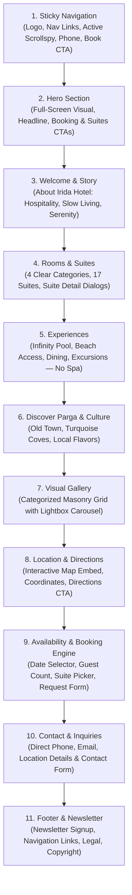

# Implementation Plan: Irida Hotel Landing Page Overhaul & Visual System

**Document Version:** 1.0  
**Target File:** `IMPLEMENTATION_UPDATE_VISUALS.md`  
**Created:** November 2026  
**Scope:** Design System, Information Architecture, Interactive Features, Copy Refinement & Progress Tracking  

---

## Executive Summary

This document establishes the master implementation plan for refining and upgrading the **Irida Hotel** web application. Located on the Ionian coastline of **Parga, Greece**, Irida Hotel delivers an intimate, upscale Mediterranean boutique experience focused on serenity, sea vistas, refined gastronomy, and personalized hospitality.

The plan translates the refined landing page prompt into concrete engineering and design tasks without altering the current codebase immediately. It provides a standardized roadmap and persistent progress checklist for subsequent development sessions across any AI developer agents or human engineers.

---

## Strategic Alignments & Answers to Core Brief Questions

| # | Question | Clarified Project Standard |
|---|---|---|
| **1** | **Exact Location & Regional Framing** | **Parga, Epirus, Ionian Coast, Greece**. Coordinates: `39.284356, 20.404706`. Headlines, location modules, and meta descriptions consistently identify Parga as the home of Irida Hotel. |
| **2** | **Media & Imagery Strategy** | **High-resolution curated Mediterranean photography**. The broken/placeholder `/hero.mp4` reference will be replaced by a full-bleed, high-resolution stock photo hero with a gentle subtle zoom/pan and soft overlay. Real video will only be added when verified hotel footage becomes available. |
| **3** | **Booking Model & Contact Channels** | **Booking Request & Concierge Confirmation System**. Website visitors submit reservation requests (dates, guest count, preferred suite, and contact details) securely saved to the Supabase database (`booking_requests`). Hotel staff confirms availability and pricing personally. **Direct Contact:** Phone: `+30 268 403 2564` \| Email: `info@iridaboutiquehotel.gr` |

---

## 1. Clean Up the Brief & Brand Identity

* **Consistent Naming Hierarchy:**
  * Canonical Primary Brand: **Irida Hotel**
  * Descriptive Tagline: *Luxury Boutique Hotel in Parga, Greece*
  * Eliminate inconsistencies (e.g., alternating erratically between "Irida Boutique Hotel" and "Irida Hotel").
* **Editorial & Copywriting Standards:**
  * Eliminate typos and awkward phrasing (e.g., replace all instances of "hig quality", "seperates", "Categorys").
  * Strip emoji and decorative iconography from section headings to preserve an editorial, tranquil luxury feel.
  * Avoid direct mentions of competitor properties; express originality through serene Mediterranean sensory descriptions (warm sun, sea breeze, natural stone, linen textures, quiet luxury).
* **Strict "No Spa" Policy:**
  * Plainly exclude any spa, massage pavilion, or wellness center references from copy, navigation items, filters, and experience cards. The hotel's appeal is rooted in the infinity pool, beach access, Mediterranean cuisine, quiet suites, and local exploration.

---

## 2. Visitor's Journey & Information Architecture

The page layout follows an emotional progression designed to guide prospective guests from awe to exploration to commitment:

### Section-by-Section Emotional Intent & Visitor Goals

1. **Header & Navigation:** Instant reassurance of luxury quality; effortless navigation; sticky presence with active section detection and permanent booking access.
2. **Hero:** Instant awe; captivates with the beauty of Parga and sea horizons; dual CTA allows guests to jump straight to booking or explore suites.
3. **About / Welcome Story:** Emotionally grounds the guest; communicates warmth, hospitality, and unhurried Mediterranean calm.
4. **Rooms & Suites:** Desire and discovery; grouped cleanly into **4 distinct categories** (Deluxe, Senior, Superior, Honeymoon) spanning **17 individual suites**, each with dedicated modal viewing and direct booking handoff.
5. **Experiences:** Lifestyle immersion; showcases the infinity pool, private beach access, seaside Mediterranean dining, and tailored excursions (strictly no spa).
6. **Local Culture & Surroundings:** Contextual romance; illustrates Parga’s vibrant Venetian castle, colorful harbor, and secluded coves.
7. **Gallery:** Visual proof & delight; multi-angle exploration of rooms, dining, pool, and sunsets with full-screen lightbox.
8. **Location:** Practical assurance; demonstrates central accessibility in Parga with an interactive Google Map and directions launcher.
9. **Booking Request Engine:** Seamless conversion; frictionless two-step request flow with real-time date checks and warm confirmation messaging.
10. **Contact:** Trust and human connection; direct phone link, email, and personal inquiry dispatch.
11. **Footer:** Graceful conclusion; newsletter capture and comprehensive navigation links.

---

## 3. Visual System & Design Language

### Color Palette (Warm Mediterranean Luxury — No Purple)

* **Backgrounds & Warm Neutrals:**
  * `sand-50` (`#fbf8f3`): Primary canvas tone, warm ivory/alabaster.
  * `sand-100` (`#f5efe4`): Secondary section backdrop, soft limestone.
  * `sand-200` (`#ebdfcb`): Subtle borders, dividers, and pill backgrounds.
  * `sand-300` (`#dcc9a8`): Focused outline borders and input framing.
* **Warm Metallic Accents:**
  * `gold-300` (`#e2c98f`): Light gold highlights for dark backdrops.
  * `gold-400` (`#d2b06a`): Muted gold for accents and tags.
  * `gold-500` (`#b8924a`): Primary brand gold for buttons, icons, and highlights.
  * `gold-600` (`#9a7535`): Deep gold for hover states and high-contrast text.
* **Deep Neutrals & Typography:**
  * `ink-900` (`#1a1815`): Deep charcoal/espresso for primary headlines and dark sections.
  * `ink-800` (`#2a2723`): Subheaders, form labels, and strong body text.
  * `ink-700` (`#3d3a35`): Crisp body prose and captions with strong readability.
* **Strict Color Constraint:** No purple, lavender, violet, or cool neon accents anywhere in the UI or assets.

### Typography System

* **Display & Headings:** `Cormorant Garamond`, serif (weights 400, 500, 600) — delivers bespoke Mediterranean elegance, generous line heights, and refined proportions.
* **Body & UI Elements:** `Inter`, sans-serif (weights 400, 500, 600) — clean, legible, high-contrast, modern UI standards.

### Spacing & Motion Language

* **Generous Rhythm:** Sections framed with `py-24 lg:py-32` to provide breathing room and avoid visual clutter.
* **Scroll-Triggered Reveals:** Gentle `fade-up` transitions with staggered timing (`Reveal` component).
* **Hover Micro-Interactions:** Subtle card elevations (`hover:-translate-y-1 hover:shadow-xl`), image hover expansions (`group-hover:scale-105`), and arrow nudges (`group-hover:translate-x-1`).
* **Modal Experiences:** Clean backdrop blur (`backdrop-blur-sm`), locked scroll, and accessible keyboard dismissal (`Escape`).

---

## 4. Technical Architecture & Component Map

| Component Path | Functionality & Target Refinements |
|---|---|
| `src/App.tsx` | Root landing page assembly; coordinates selected suite state between `Rooms`, `SuiteDialog`, and `Booking`. |
| `src/components/Navbar.tsx` | Fixed sticky header, mobile drawer menu, phone direct dial, book CTA button, and **active scrollspy highlighting**. |
| `src/components/Hero.tsx` | Full-screen responsive hero image (replacing missing `/hero.mp4`), darkening gradient, headline, and dual CTAs. |
| `src/components/About.tsx` | Story of Irida Hotel, boutique credentials, serene image collage, and key hospitality pillars. |
| `src/components/Rooms.tsx` | 4 suite category groups with counts, suite card grid, photo badges, and trigger for `SuiteDialog`. |
| `src/components/SuiteDialog.tsx` | Full suite inspection modal: image gallery carousel, description, specifications, and "Book This Suite" action. |
| `src/components/Experiences.tsx` | 4 featured hotel experiences: Infinity Pool, Beach Access, Mediterranean Dining, Bespoke Excursions (strictly no spa). |
| `src/components/LocalCulture.tsx` | Discovering Parga: crystal coves, Venetian architecture, dining, and scenic coastline. |
| `src/components/Gallery.tsx` | Filterable image gallery (`All`, `Views`, `Pool`, `Suites`, `Dining`, `Coast`, `Guests`) and full-screen lightbox modal. |
| `src/components/Location.tsx` | Embedded interactive Google Map (`Parga, Greece`), highlight badges, and external Google Maps directions link. |
| `src/components/Booking.tsx` | Two-step booking engine: dates + guest + suite selection; guest details; Supabase `booking_requests` insertion; confirmation message. |
| `src/components/Contact.tsx` | Direct contact cards (phone, email, address) + inquiry message form submitting to Supabase `contact_messages`. |
| `src/components/Footer.tsx` | Brand badge, explore navigation, direct contact, newsletter form submitting to `newsletter_subscribers`, and copyright. |
| `src/lib/siteData.ts` | Centralized data source: photography URLs, suite categories, experiences, gallery entries, and hotel metadata. |
| `src/lib/suites.ts` | Suite data definitions (17 unique suites across the 4 categories) with detailed photos and descriptions. |
| `src/lib/supabase.ts` | Supabase client initialization for database insertions. |
| `index.html` | SEO title, meta descriptions, Open Graph data, favicon, and Google Fonts pre-connections. |

---

## Master Implementation Checklist

Use this checklist to track progress sequentially across development sessions:

### Phase 1: Brand Consistency & Copy Polish
- [ ] **1.1 Canonical Brand Naming:** Verify "Irida Hotel" is used uniformly across headers, copy, buttons, and footers (avoiding conflicting "Irida Boutique Hotel" mentions in UI labels).
- [ ] **1.2 Clean Up Section Headings:** Remove decorative icons/emojis from heading titles; format as clean editorial typography.
- [ ] **1.3 Typography & Spelling Audit:** Audit all copy to verify correction of typos ("hig quality", "seperates", "Categorys").
- [ ] **1.4 "No Spa" Verification:** Ensure zero references to spa, sauna, or massages exist across `siteData.ts`, `Experiences.tsx`, and copy.
- [ ] **1.5 Evocative Section Subtitles:** Confirm each section begins with a clear, calming sentence establishing what the visitor will experience.

### Phase 2: Navigation & Hero Upgrades
- [ ] **2.1 Active Section Scrollspy in Navbar:** Implement dynamic active-state tracking (e.g., IntersectionObserver or window scroll detection) so navigation links highlight the active section automatically.
- [ ] **2.2 Mobile Navigation Drawer:** Test hamburger toggle, smooth drawer slide, and ensure tapping any link auto-closes the menu and scrolls smoothly to target.
- [ ] **2.3 Hero Media Replacement:** Cleanly remove the unresolvable `/hero.mp4` video tag from `Hero.tsx` and implement a high-resolution, responsive photography background with subtle CSS zoom/cinematic tone.
- [ ] **2.4 Hero Readability & Overlay:** Refine overlay gradients to ensure optimal readability for white text over high-key coastal images across mobile and desktop.
- [ ] **2.5 Dual CTAs in Hero:** Maintain primary "Book Your Stay" button (jumps to `#booking`) and secondary "View Rooms and Suites" button (jumps to `#rooms`).

### Phase 3: Accommodations & Suite Browsing Experience
- [ ] **3.1 Four Categorical Groups:** Verify clear presentation of the 4 groups:
  - [ ] *Deluxe Suites* (Jasmin, Lotus, SunBeam, Sand)
  - [ ] *Senior Suites* (Coral, Pearl, Waves, Shell, Anemone)
  - [ ] *Superior Suites* (Flower, Grapes, Water Lily, Poppy, Pebbles)
  - [ ] *Honeymoon Suites* (Branches, Stars, Olive)
- [ ] **3.2 Suite Card Polish:** Confirm each suite card displays high-resolution preview, photo count indicator, suite title, summary, and "View Suite" prompt.
- [ ] **3.3 Suite Dialog / Modal Flow:** Verify clicking any suite opens `SuiteDialog.tsx` with photo cycling, detailed description, amenities/details, and a direct "Book This Suite" CTA that preselects the suite in `#booking`.
- [ ] **3.4 Modal Accessibility:** Ensure modal traps focus, locks body scroll while open, and closes gracefully via backdrop click, `X` button, or `Escape` key.

### Phase 4: Experiences, Gallery & Location
- [ ] **4.1 Experiences Grid:** Verify cards for *Infinity Pool*, *Beach Access*, *Dining*, and *Optional Activities* feature evocative photography and consistent hover zoom states.
- [ ] **4.2 Discover Parga Section:** Verify `LocalCulture.tsx` articulates Parga’s Venetian history, vibrant harbor, and emerald bays.
- [ ] **4.3 Gallery Filters & Masonry:** Test filter tabs (`All`, `Views`, `Pool`, `Suites`, `Dining`, `Coast`, `Guests`) for seamless filtering.
- [ ] **4.4 Gallery Lightbox:** Verify full-screen lightbox modal supports forward/backward navigation via arrows, on-screen buttons, and `Escape` key.
- [ ] **4.5 Location Map & Directions:** Verify Google Map iframe embeds Parga coordinates (`39.284356, 20.404706`) and the "Get Directions" button opens Google Maps in a new tab.

### Phase 5: Interactive Engines & Data Storage
- [ ] **5.1 Booking Date Validation:** Verify arrival date cannot be in the past; departure date must be at least one day after arrival.
- [ ] **5.2 Booking Guest & Suite Selectors:** Verify guests range from 1 to 10; suite dropdown lists all 17 suites grouped under the 4 categories, plus "Any suite".
- [ ] **5.3 Booking Submission & Confirmation:** Verify booking request submits to Supabase table `booking_requests` and transitions immediately to a friendly confirmation screen with reset option.
- [ ] **5.4 Contact Form Validation & Submission:** Verify name, valid email regex, and message inputs submit to Supabase `contact_messages` and display a thank-you status.
- [ ] **5.5 Newsletter Subscription:** Verify email subscription saves to `newsletter_subscribers`, catches unique email constraint gracefully, and provides clear user feedback.

### Phase 6: SEO, Accessibility & Quality Assurance
- [ ] **6.1 SEO Meta Audit (`index.html`):** Ensure page title and meta description prominently highlight "Irida Hotel", "Parga, Greece", "Luxury Suites", and direct booking.
- [ ] **6.2 Semantic HTML & Headings:** Ensure logical hierarchy (`h1` in hero, `h2` for main sections, `h3` for categories/cards, `h4` for suite items).
- [ ] **6.3 Image Attributes:** Confirm all image tags feature explicit `alt` descriptions and `loading="lazy"` (except above-the-fold hero).
- [ ] **6.4 Mobile Responsiveness Check:** Verify padding, font scale, button touch targets (min 44px), and layouts across viewport widths: 375px (mobile), 768px (tablet), 1024px (desktop), 1440px (wide).
- [ ] **6.5 Zero Console Errors & Typecheck:** Run `npm run typecheck` and `npm run build` to guarantee error-free compilation.

---

## Verification & Execution Protocol

When ready to begin code implementation in subsequent turns:
1. Run `npm run typecheck` to confirm the baseline TypeScript build is passing.
2. Implement updates iteratively, checking off items in this document as they are fulfilled.
3. Review changes against visual design specifications (colors, serif headings, soft gold accents, no purple).
4. Verify Supabase tables and submissions remain completely functional.
